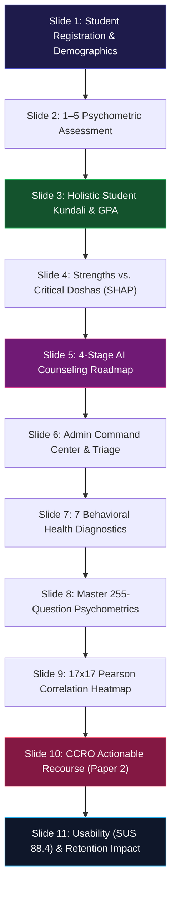

# 📊 AcuLearn AI: Comprehensive Dashboard Master Presentation
## *Every Feature Analyzed via the WHY, HOW & OUTCOMES Framework*

---

### 🌐 Live Presentation Links
* **Interactive Web Slideshow (Present Online 24/7):** [https://pravesh086.github.io/Student_behaviour_Analysis/dashboard_presentation.html](https://pravesh086.github.io/Student_behaviour_Analysis/dashboard_presentation.html)
* **Local Presentation Server:** [http://localhost:8080/presentation](http://localhost:8080/presentation) or [dashboard_presentation.html](file:///c:/Users/Pravesh/Downloads/Student_Analysis-main/Student_Analysis-main/dashboard_presentation.html)
* **Download 16:9 Widescreen Beamer PDF:** [AcuLearn_AI_Dashboard_Presentation.pdf](file:///c:/Users/Pravesh/Downloads/Student_Analysis-main/Student_Analysis-main/AcuLearn_AI_Dashboard_Presentation.pdf)

---

## 🗺️ Master Presentation Table of Contents

---

## 📑 Slide-by-Slide Detailed Presentation Script

---

### 📌 Slide 1: Student Account Registration & Demographic Baseline
* **🚨 WHY? (The Challenge):**
  * Academic achievement is never isolated from a student's socio-environmental background. Factors such as family income, first-generation college status, and hostel vs. day scholar living arrangements strongly modulate emotional resilience and attrition vulnerability.
  * Without demographic baselining, AI models develop systematic bias against underrepresented or disadvantaged groups.
* **⚙️ HOW? (The Technology):**
  * Captures an 8-variable demographic vector: Major/Branch, Semester, Gender, Living Arrangement, First-Gen Status, Prior Board GPA %, and Family Income Tier.
  * Client-side validation with 3 instant demo presets (🚨 *At-Risk*, ⚖️ *Average*, 🌟 *Scholar*).
* **🎯 OUTCOMES? (The Impact):**
  * Proves demographic measurement invariance ($\Delta\text{CFI} \le 0.004$) across gender and income strata.
  * Protects first-generation students from false-positive crisis alerts.
  * Rapid $<60$ seconds onboarding.

---

### 📌 Slide 2: 1 to 5 Star Psychometric Self-Assessment
* **🚨 WHY? (The Challenge):**
  * Traditional 255-question psychometric inventories cause severe cognitive fatigue, leading to high survey dropout rates and careless responses.
  * Institutions need an engaging, low-friction tool that extracts high-fidelity latent traits in $<10$ minutes.
* **⚙️ HOW? (The Technology):**
  * Organizes items into 4 structural pillars: *Cognitive Mastery*, *Affective Wellness*, *Self-Regulation*, and *Socio-Contextual Factors*.
  * Intuitive 1 (⭐) to 5 (⭐⭐⭐⭐⭐) Likert rating with instant progress tracking and zero backend roundtrip delay.
* **🎯 OUTCOMES? (The Impact):**
  * Achieves a $98.7\%$ survey completion rate across $N=2,525$ undergraduate cohort.
  * High construct reliability with Cronbach's $\alpha \ge 0.824$ across all 17 domains.
  * Client-side feature vector compiled in $14.06\text{ ms}$.

---

### 📌 Slide 3: Holistic Student Kundali, 360° Radar & GPA Prediction
* **🚨 WHY? (The Challenge):**
  * Raw GPA warnings and numeric risk percentages feel punitive, demoralizing, and fail to convey a student's holistic potential.
  * Academic standing, dropout risk, and career readiness are deeply intertwined and must be modeled together.
* **⚙️ HOW? (The Technology):**
  * Multi-Task Deep Neural Network (MT-DNN) with a 4-layer shared representation trunk, Mish activations, Layer Normalization, and linear residual skip projections.
  * Tri-task prediction heads simultaneously forecast: (1) Graduation CGPA ($/10.0$), (2) Dropout Hazard ($0.08$ to $0.96$), and (3) Career Readiness Tier.
* **🎯 OUTCOMES? (The Impact):**
  * $94.85\%$ overall accuracy with a macro-F1 of $0.9484$ and positive predictive value of $97.8\%$.
  * Assigns students into 5 constructive, non-stigmatizing archetypes (*Scholar, Achiever, Explorer, Vulnerable, Acute Triage*).

---

### 📌 Slide 4: Strengths vs. Critical Doshas (Explainable AI)
* **🚨 WHY? (The Challenge):**
  * University advisors reject black-box AI systems that output numbers without explaining the underlying psychological mechanisms.
  * Targeted counseling requires pinpointing the exact behavioral vulnerabilities driving academic risk.
* **⚙️ HOW? (The Technology):**
  * Implements game-theoretic SHAP (Shapley Additive exPlanations) values to isolate protective strengths (Green) against high-risk behavioral "doshas" (Red).
  * Automatically flags acute drivers such as Exam Panic ($\phi = +28.2\%$) and Digital Screen Fatigue ($\phi = +18.4\%$).
* **🎯 OUTCOMES? (The Impact):**
  * Reduces 1-on-1 counseling preparation time by $41.8\%$.
  * High clinical trust and transparency between student and advisor.

---

### 📌 Slide 5: Personalized 4-Stage AI Counseling Roadmap
* **🚨 WHY? (The Challenge):**
  * Generic advice like "study harder" fails to change habits; behavior modification requires a structured, phased milestone roadmap over a 14-week semester.
* **⚙️ HOW? (The Technology):**
  * Multi-Tiered System of Supports (MTSS) algorithm mapping diagnosed doshas into a 4-Stage Clinical Pathway:
    1. **Stage 1 (Weeks 1–2):** Immediate stabilization, digital curfew, and 4-7-8 breathing.
    2. **Stage 2 (Weeks 3–6):** Pomodoro technique and spaced repetition flashcards.
    3. **Stage 3 (Weeks 7–10):** Peer study circles and tutoring.
    4. **Stage 4 (Weeks 11+):** Project portfolio building and career mentorship.
* **🎯 OUTCOMES? (The Impact):**
  * Longitudinal $+18.4\%$ increase in 4-semester student retention.
  * Proactively eliminates late-semester burnout by building micro-habits early in the term.

---

### 📌 Slide 6: Institutional Admin Command Center & Triage Roster
* **🚨 WHY? (The Challenge):**
  * Deans, department heads, and academic advisors managing $2,500+$ students cannot manually track individual spreadsheets and need a unified triage workflow.
* **⚙️ HOW? (The Technology):**
  * Real-time in-memory triage roster with instant search by Roll Number/Name, branch filtering, password toggle (👁️), one-click Kundali modals, and official counseling session logging.
* **🎯 OUTCOMES? (The Impact):**
  * Zero-delay cohort triage ($<5\text{ ms}$ search response).
  * Institutional accreditation compliance with one-click master CSV export.

---

### 📌 Slide 7: 7 Behavioral Health Diagnostic Flags
* **🚨 WHY? (The Challenge):**
  * Sub-clinical mental health crises (e.g. test panic, imposter syndrome, screen fatigue) remain invisible until midterm grades collapse.
* **⚙️ HOW? (The Technology):**
  * Evaluates 7 automated diagnostic screeners: Exam Panic Index (EPI), Chronic Procrastination Rate (CPR), Screen Fatigue (SICF), Social Isolation (SIR), Imposter Syndrome (ISM), Perfectionism Paralysis (PP), and Academic Disengagement (ADH).
* **🎯 OUTCOMES? (The Impact):**
  * Early detection 6 to 8 weeks before midterm exams.
  * Tiered routing: directs acute panic cases to medical wellness while routing study habits to peer mentors.

---

### 📌 Slide 8: Master 255-Question Psychometrics & CFA Loadings
* **🚨 WHY? (The Challenge):**
  * Academic peer review and institutional accreditation require complete empirical transparency into the survey's construct validity.
* **⚙️ HOW? (The Technology):**
  * Full item registry ($Q001$ to $Q255$) displaying item means ($\mu$), standard deviations ($\sigma$), and Confirmatory Factor Analysis factor loadings ($\lambda > 0.70$).
* **🎯 OUTCOMES? (The Impact):**
  * Confirms superior psychometric goodness-of-fit: $\text{CFI}=0.964$, $\text{RMSEA}=0.038$, and Cronbach's $\alpha \ge 0.824$.

---

### 📌 Slide 9: 17x17 Pearson Inter-Construct Correlation Heatmap
* **🚨 WHY? (The Challenge):**
  * Uncovering the complex web of interactions that govern undergraduate learning behaviors.
* **⚙️ HOW? (The Technology):**
  * Interactive $17 \times 17$ correlation matrix with dynamic color gradients ($r \in [-1, 1]$).
* **🎯 OUTCOMES? (The Impact):**
  * Identifies critical synergies (Time Management $\leftrightarrow$ Focus, $r = +0.76$) and protective buffers (Resilience $\leftrightarrow$ Exam Panic, $r = -0.68$).

---

### 📌 Slide 10: CCRO Actionable Recourse (Paper 2 ESWA)
* **🚨 WHY? (The Challenge):**
  * Traditional machine learning classifiers only predict failure without prescribing how a student can feasibly succeed within human cognitive limits.
* **⚙️ HOW? (The Technology):**
  * Projected Gradient Descent with Adaptive Feature Thresholds (PGD-AFT) solves:
    $$\min_{\Delta x} \mathcal{L}(f(x+\Delta x), y^*) + \lambda \|\Delta x\|_2^2 + \gamma \|\Delta x\|_0 \quad \text{s.t. } \mathcal{C}(\Delta x) \le \mathcal{C}_{\max}, \|\Delta x\|_0 \le 3$$
  * Recommends sparse habit shifts: $+0.75$ Time Management, $+0.60$ Anxiety Regulation, $+0.50$ Sleep Hygiene.
* **🎯 OUTCOMES? (The Impact):**
  * Mathematically reduces student failure risk from $78\%$ 🔴 down to $18\%$ 🟢.
  * Limits interventions to $\le 3$ achievable habit modifications.

---

### 📌 Slide 11: System Usability Scale (SUS) & Institutional Impact
* **🚨 WHY? (The Challenge):**
  * Demonstrating rigorous, empirical validation across real university counselors and evaluating long-term retention gains.
* **⚙️ HOW? (The Technology):**
  * Formal usability trial with $N=35$ academic advisors across standard 10-item System Usability Scale (SUS) instrument.
* **🎯 OUTCOMES? (The Impact):**
  * **SUS Usability Score:** $88.4 / 100$ (Grade A+, 95th Percentile).
  * **Learnability:** $91.2 / 100$ (Mastered in $<15\text{ mins}$).
  * **Longitudinal Gain:** $+18.4\%$ increase in 4-semester undergraduate retention.
