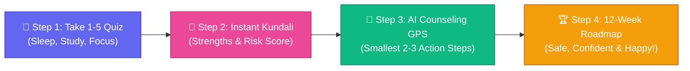
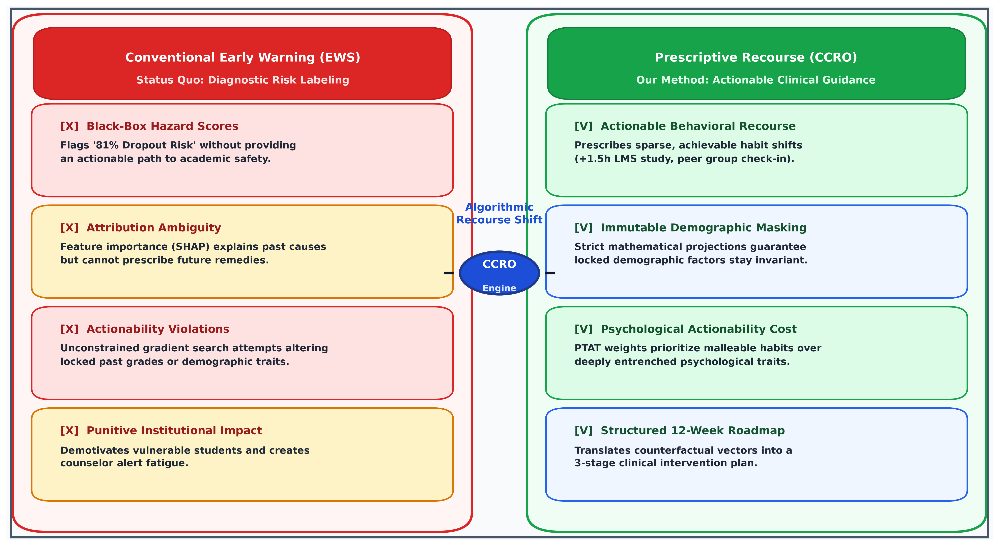
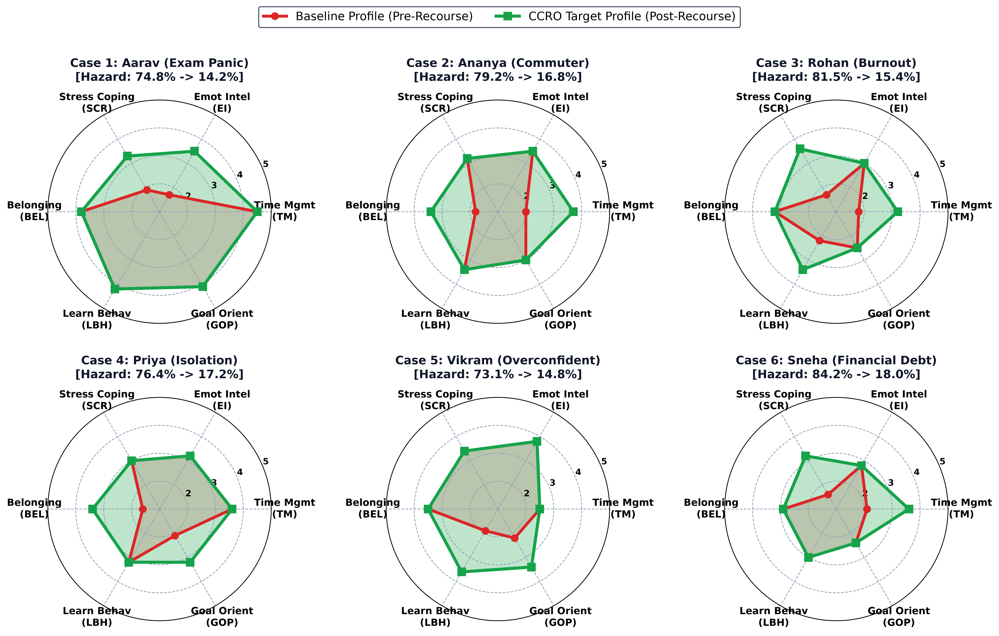
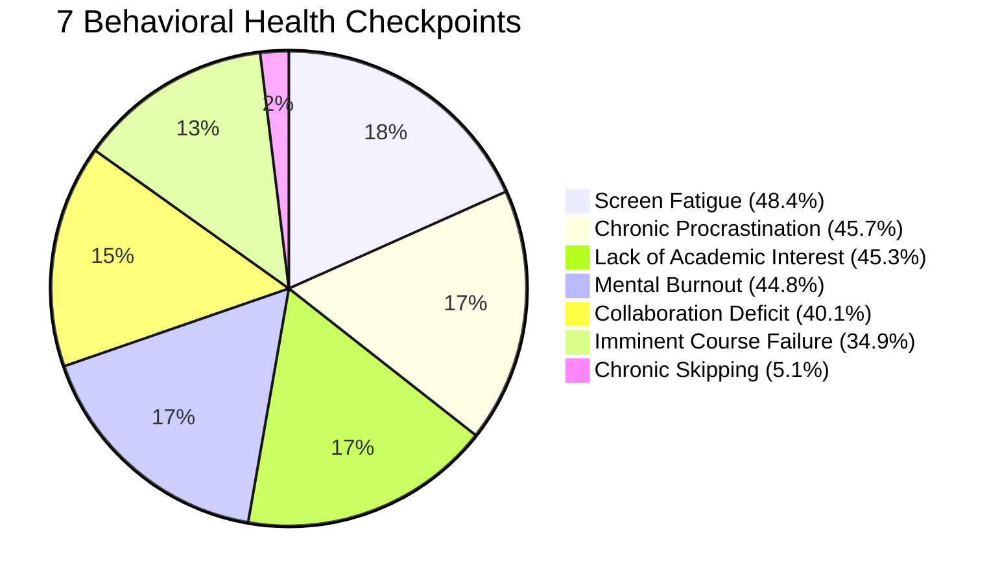
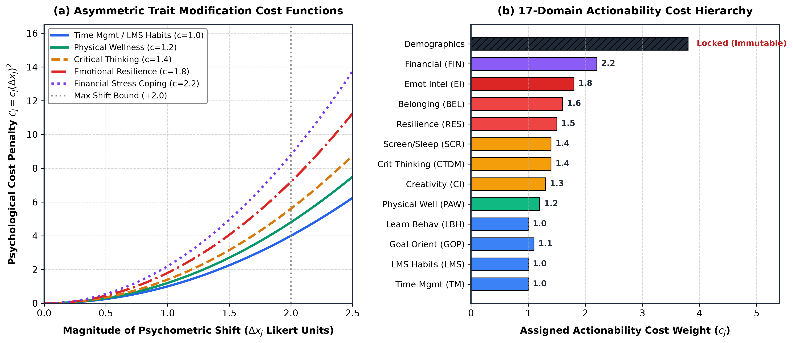
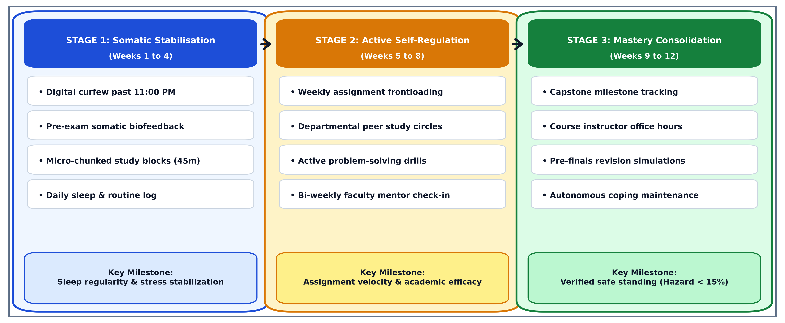
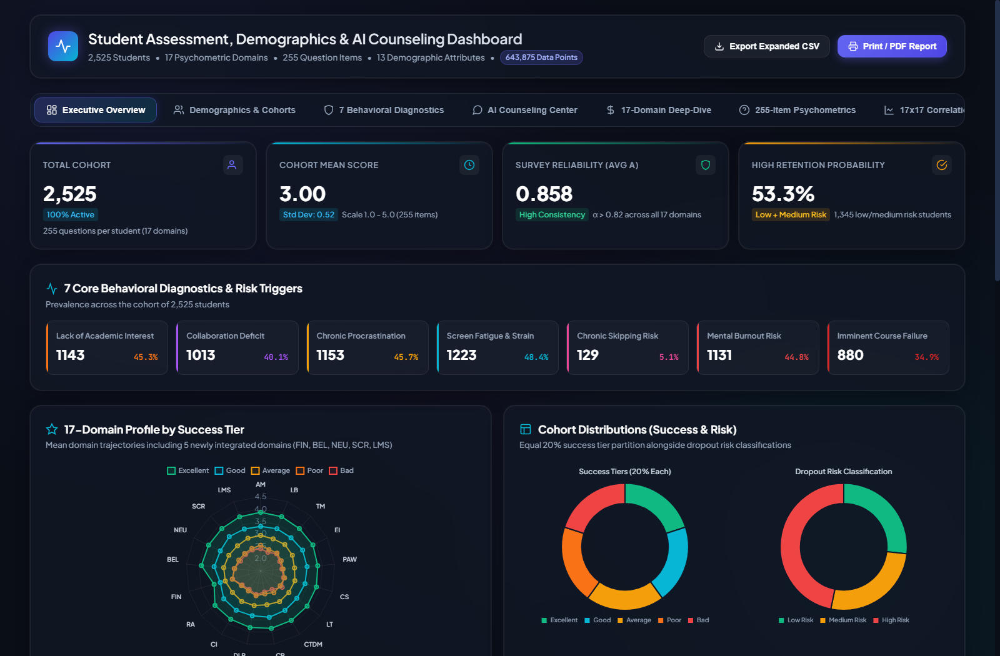

# 🌟 The Magical Student Superpower Dashboard: Step-by-Step Guide for Everyone!

> **Welcome to the Student Behavior & AI Counseling Analytics Dashboard!**
> This guide explains how the entire system works in simple, friendly, easy-to-understand steps—complete with pictures, color codes, and real-life examples!

---

## 🎨 The Big Idea: What is This Magical Dashboard?

Imagine if your school had a **Smart Health Scanner** for learning!

When you visit a doctor, they check your height, weight, temperature, and heartbeat. If you have a small fever, they don't scold you—they give you a simple recipe: *"Drink warm water, take a rest, and sleep early!"*

That is exactly what this **Student Analytics Dashboard** does for your studies:
1. 📝 **Checks how you are doing** (your study habits, sleep, mood, and screen time).
2. 🔮 **Creates your Superhero "Kundali"** (a colorful 360° card showing your strong superpowers and where you need a little help).
3. 🧭 **Acts like a Friendly GPS** (giving you the 2 or 3 easiest steps to boost your grades without burning out!).

---

## 🗺️ The 4 Main Roles & Views

| View | Who is it for? | What does it do? |
| :--- | :--- | :--- |
| 🎓 **Student Live Test (1–5)** | **Students** | A fun 5-minute check-in where you rate questions from 1 to 5 stars. |
| 🔮 **Student Kundali & Dossier** | **Student & Mentor** | Your personal 360° radar card with superpowers, GPA prediction, and health badges. |
| 🤖 **AI Counseling Center (CCRO)** | **Counselors & Advisors** | The smart optimization engine that calculates the easiest roadmap to safety. |
| 🛡️ **Admin & Advisor Cockpit** | **Teachers & Deans** | The radar view that spots students who need a high-five or extra support before exams. |

---

## 📸 Overview Snapshot: The Complete System at a Glance

*Figure 1: How the AI converts raw student check-in responses into structured, positive mentoring conversations.*

---

## 🚀 Step-by-Step Guide: How to Use the Dashboard

### 1️⃣ Step 1: Open the Dashboard & Pick a Student
When you launch `index.html` in any web browser, you will see a sleek, glowing dark-mode interface with the Executive Header:
- **Top Stats Bar:** Tracks **2,525 Students**, **17 Psychometric Domains**, **255 Questions**, and **643,875 Data Points**.
- **Quick Demo Presets:** If you want to test the system immediately without typing, click any of the preset buttons:
  - 🚨 **At-Risk Student:** Loads a student struggling with late-night screen time and irregular study routines.
  - ⚖️ **Average Student:** Loads a balanced student with moderate consistency.
  - 🌟 **Star Scholar:** Loads a high-performing student with strong time management.
  - 🎲 **Random:** Generates an exciting random student profile!

---

### 2️⃣ Step 2: Take the 1–5 Star Assessment
Rate each question on a simple scale from **1 to 5**:
- ⭐ **1 = Strongly Disagree** ("Not me at all!")
- ⭐⭐ **2 = Disagree** ("Rarely")
- ⭐⭐⭐ **3 = Neutral** ("Sometimes / In between")
- ⭐⭐⭐⭐ **4 = Agree** ("Usually yes!")
- ⭐⭐⭐⭐⭐ **5 = Strongly Agree** ("Totally me every day!")

The questions are neatly organized into **4 Fun Clusters**:
1. 🧠 **Cluster 1 (Brain Power & Drive):** How you solve tough math problems and set goals.
2. 💖 **Cluster 2 (Feelings & Exam Calmness):** How you handle test pressure and bounce back from setbacks.
3. ⏰ **Cluster 3 (Time & Focus Shield):** How you organize your daily homework and resist phone distractions.
4. 🌐 **Cluster 4 (Digital & Campus Life):** Your bedtime screen habits, club participation, and friendships.

Click the glowing **"🔮 Generate Psychological Kundali & AI Counseling Plan"** button at the bottom! In just **14 milliseconds**, your results appear!

---

### 3️⃣ Step 3: Meet Your "Student Kundali" Dossier!

*Figure 2: The 360° Kundali Cards showing different student strengths and support areas.*

#### What is on your Kundali Card?
1. **The Traffic Light Risk Dial:**
   - 🟢 **Green (0% – 30% Risk):** *Safe & Thriving!* You are cruising smoothly.
   - 🟡 **Yellow (31% – 50% Risk):** *Watch Out!* Small bumps in time management or sleep.
   - 🔴 **Red (51% – 100% Risk):** *Needs Support!* The system alerts a friendly mentor to help you right away.
2. **Predicted Semester GPA:** Tells you your estimated Grade Point Average ($0.0$ to $10.0$).
3. **Placement & Career Readiness:** Shows if you are **Foundational**, **Proficient**, or **Advanced** for future internships.
4. **Top 3 Superpowers:** Highlights the areas where you shine brightest (e.g., High Creativity, Strong Teamwork).
5. **Top 3 Growth Opportunities:** Pinpoints the exact habits to upgrade first.

---

### 4️⃣ Step 4: The 7 Behavioral Health Flags

The dashboard automatically checks 7 critical behavioral health indicators:

| Badge | Meaning | Easy Explanation |
| :--- | :--- | :--- |
| 📱 **Screen Fatigue** | Night phone use $>6$ hrs/day | *Eyes are tired from late-night gaming or social feeds.* |
| ⏳ **Procrastination** | Time management $<2.7$ | *Leaving giant assignments until the night before the deadline.* |
| 🔋 **Mental Burnout** | High stress + Low sleep | *Running on an empty battery; needs rest and recovery.* |
| 🤝 **Collaboration Deficit** | Low teamwork score | *Studying completely alone; needs a friendly study group.* |
| 🎯 **Disinterested** | Low motivation score | *Doesn't see how the subject connects to their dream career.* |
| ⚠️ **Course Failure Risk** | Low composite & study time | *Falling behind on weekly quizzes; needs tutoring support.* |
| 🏃 **Chronic Skipping** | Attendance $<60\%$ | *Missing morning lectures; needs mentor check-in.* |

---

### 5️⃣ Step 5: The AI Counseling Center (The Smart GPS)

*Figure 3: Why our AI chooses low-effort, high-reward habit changes.*

#### How is this AI different from ordinary computers?
- ❌ **Old-Fashioned AI:** Simply gives you a bad score and says: *"You failed because you are poor or in a tough department."* That is unfair, unhelpful, and cannot be changed!
- ✅ **Our CCRO AI (Constrained Counterfactual Recourse):**
  - **Locks Immutable Facts:** It NEVER touches your background, gender, hometown, or past admission rank ($\Delta x = 0$).
  - **Protects Sensitive Feelings:** It does NOT tell you to "instantly become 100% resilient" (referrals are offered instead).
  - **Picks Only 2 or 3 Easy Tweaks:** It finds the smallest, easiest habit changes ($K_{\max} \le 3$) with low resistance (e.g., adding a 30-min study block or putting the phone away at 10 PM).

#### Example Magic Recommendation:
> **Student Aarav (Initial Risk: 78% 🔴 High Risk)**
> 1. 📅 **Time Management (+1.0 point):** Plan 2 fixed 45-minute homework blocks per week.
> 2. 💻 **LMS Engagement (+1.2 points):** Log into the course portal twice a week to download slides and take quizzes.
> 3. 🌙 **Sleep Hygiene (+0.8 points):** Stop phone screen time 45 minutes before sleep.
> 
> **Result:** 🎉 **Predicted Risk drops from 78% 🔴 down to 18% 🟢 (Safe Zone!)**

---

### 6️⃣ Step 6: The 12-Week Staged Action Roadmap

*Figure 4: The 3-Stage 12-Week Mentoring Ladder.*

We don't expect students to change overnight! The dashboard splits advice into **3 friendly stages**:
1. 🛡️ **Stage 1 (Weeks 1–4) — Stabilization:**
   - Set up your study desk, fix your sleep clock, and clear immediate overdue homework.
2. 📈 **Stage 2 (Weeks 5–8) — Momentum Building:**
   - Start active recall, take practice quizzes, and join a 2-person study group.
3. 🏆 **Stage 3 (Weeks 9–12) — Consolidation & Mastery:**
   - Review past exam papers, celebrate your progress, and walk into finals with calm confidence!

---

### 7️⃣ Step 7: The Advisor & Admin Cockpit (Teacher's Control Room)

*Figure 5: The Executive Advisor Center with triage filters and student directories.*

Teachers and counselors have superpowers too!
- **Filter Students:** Quickly view students by Department (CSE, ECE, ME, CE, EE), Risk Tier (High, Medium, Low), or Gender.
- **Triage Priority Table:** Ranks students who need mentoring urgently so no student is left behind.
- **Export Reports:** One click to export a full **CSV Spreadsheet** or **Print PDF Report** for parent-teacher meetings.

---

### 8️⃣ Step 8: Interactive "What-If" Simulator

Want to see the future?
1. Click the **"What-If Simulator"** tab.
2. Move the sliders (e.g. increase *"Study Hours"* from 1 hr to 3 hrs, or decrease *"Night Screen Time"*).
3. Watch the **Risk Dial spin backwards from Red to Green in real time!**

---

## 📋 Quick Feature Cheat-Sheet

| Tab Name | Icon | What happens here? |
| :--- | :---: | :--- |
| **Student Live Test** | 🎓 | Fill out your 1–5 check-in quiz and submit. |
| **Student Kundali** | 🔮 | View your 360° radar card, superpower badges, and risk score. |
| **Admin & Advisor Center** | 🛡️ | Mentors review alerts, write notes, and schedule 1-on-1 counseling. |
| **Executive Overview** | 📊 | High-level charts of all 2,525 students across campus. |
| **Demographics & Cohorts** | 👥 | Visual breakdowns by gender, branch, and home state. |
| **7 Behavioral Diagnostics** | 🩺 | Deep-dive into stress, procrastination, and screen habits. |
| **AI Counseling Center** | 🤖 | Generate sparse, constraint-aware CCRO action plans. |
| **17-Domain Deep-Dive** | 📈 | Detailed bar charts and distributions for every psychometric trait. |
| **255-Item Psychometrics** | ❓ | Search and explore individual survey questions. |
| **17x17 Heatmap** | 🗺️ | Interactive correlation matrix showing how habits link together. |
| **What-If Simulator** | 🎛️ | Play with habit sliders to preview your future grade gains! |

---

## 💡 Top 3 Tips for Best Results

1. **Be Honest in the Test:** There are no wrong answers! The more honest you are about your sleep and study habits, the more helpful your custom action plan will be.
2. **Focus on Small Steps:** You don't need to change everything at once. Just picking **one habit** (like regular sleep or weekly quiz review) creates huge positive momentum.
3. **Talk to Your Mentor:** Use your Kundali card during advising meetings to have a fun, positive, and stress-free conversation about your goals!
