# 📘 Complete Pictorial User Manual: Student Analytics, Assessment & Admin Portal
### *A Step-by-Step Visual Walkthrough with High-Resolution System Snapshots*

---

## 🌐 Public Cloud Access Links (Available 24/7 Worldwide)
* **Master Institutional Dashboard (All 12 Tabs):** [https://pravesh086.github.io/Student_behaviour_Analysis/](https://pravesh086.github.io/Student_behaviour_Analysis/)
* **Student Registration & Assessment Portal:** [https://pravesh086.github.io/Student_behaviour_Analysis/student_portal.html](https://pravesh086.github.io/Student_behaviour_Analysis/student_portal.html)
* **CCRO Mentor Decision Dashboard (Paper 2):** [https://pravesh086.github.io/Student_behaviour_Analysis/ccro_dashboard.html](https://pravesh086.github.io/Student_behaviour_Analysis/ccro_dashboard.html)
* **Standalone 1–5 Test Portal:** [https://pravesh086.github.io/Student_behaviour_Analysis/student_test_portal.html](https://pravesh086.github.io/Student_behaviour_Analysis/student_test_portal.html)

---

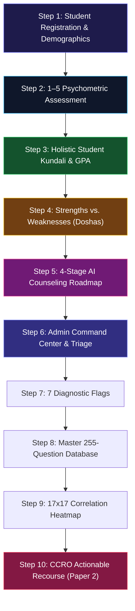

---

## 📸 Step 1: Student Account Registration & Demographic Intake

### 🎯 Purpose & Overview
Every student begins by creating their institutional profile. This establishes their baseline demographic background and registers their secure login credentials into the institutional Admin Portal.

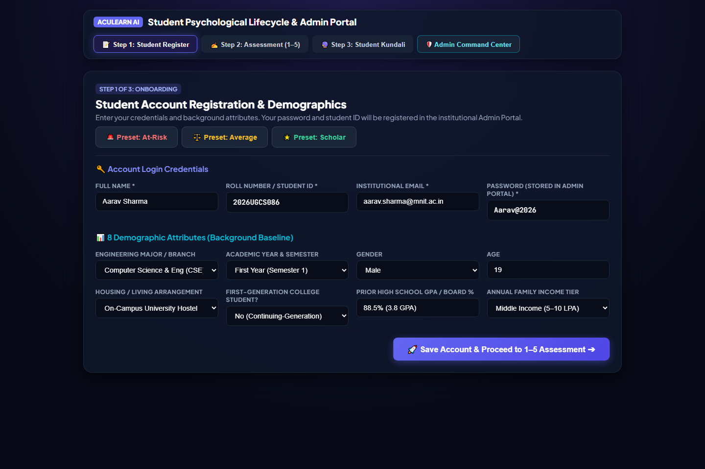

### 🛠️ How It Works:
1. **Account Credentials:** The student enters their **Full Name**, **Roll Number / Student ID** (e.g., `2026UGCS086`), **Institutional Email**, and chooses a **Password**.
2. **8 Demographic Baseline Attributes:**
   * *Engineering Major / Branch* (CSE, ECE, EE, ME, Civil, Chemical, etc.)
   * *Academic Year & Semester* (Semesters 1 through 8)
   * *Gender* (Male, Female, Non-Binary)
   * *Age*
   * *Living Arrangement* (Hostel Resident vs. Day Scholar)
   * *First-Generation Status* (First-Gen vs. Continuing-Gen)
   * *Prior Academic Baseline* (High School / Board GPA %)
   * *Family Socioeconomic Tier* (Low $<3$ LPA, Middle $5-10$ LPA, High $>15$ LPA)
3. **Quick Demo Presets:** Users can click **🚨 Preset: At-Risk**, **⚖️ Preset: Average**, or **🌟 Preset: Scholar** to instantly populate realistic sample profiles.
4. **Action:** Click **`🚀 Save Account & Proceed to 1–5 Assessment ➔`**.

---

## 📸 Step 2: 1–5 Star Psychometric Self-Assessment

### 🎯 Purpose & Overview
Students complete a validated questionnaire evaluating their cognitive, emotional, behavioral, and environmental learning habits on an intuitive 1 (Strongly Disagree) to 5 (Strongly Agree) Likert scale.

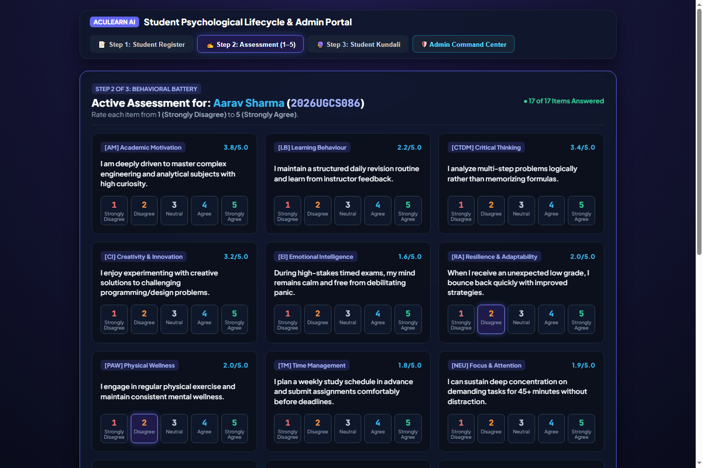

### 🛠️ How It Works:
1. **4 Structural Pillars:**
   * **Cognitive Mastery:** Academic motivation, deep learning habits, critical thinking, creativity.
   * **Affective & Resilience:** Emotional stability, test anxiety regulation, grit, physical stamina.
   * **Self-Regulation:** Time management, focus / anti-procrastination, communication, teamwork.
   * **Socio-Contextual:** Digital well-being, campus belonging, LMS usability, career readiness.
2. **Interactive Likert Rating:** The student selects ratings from **1 (⭐)** to **5 (⭐⭐⭐⭐⭐)** for each construct card.
3. **Progress Bar:** Real-time visual progress counter updates dynamically as questions are answered.
4. **Action:** Click **`🔮 Submit Survey & Generate My Kundali ➔`**.

---

## 📸 Step 3: Holistic Student Kundali, 360° Radar & CGPA Prediction

### 🎯 Purpose & Overview
Upon submission, the platform's multi-task deep neural network instantly computes a comprehensive **Student Kundali**—a 360° visual psychological horoscope and academic health dossier.

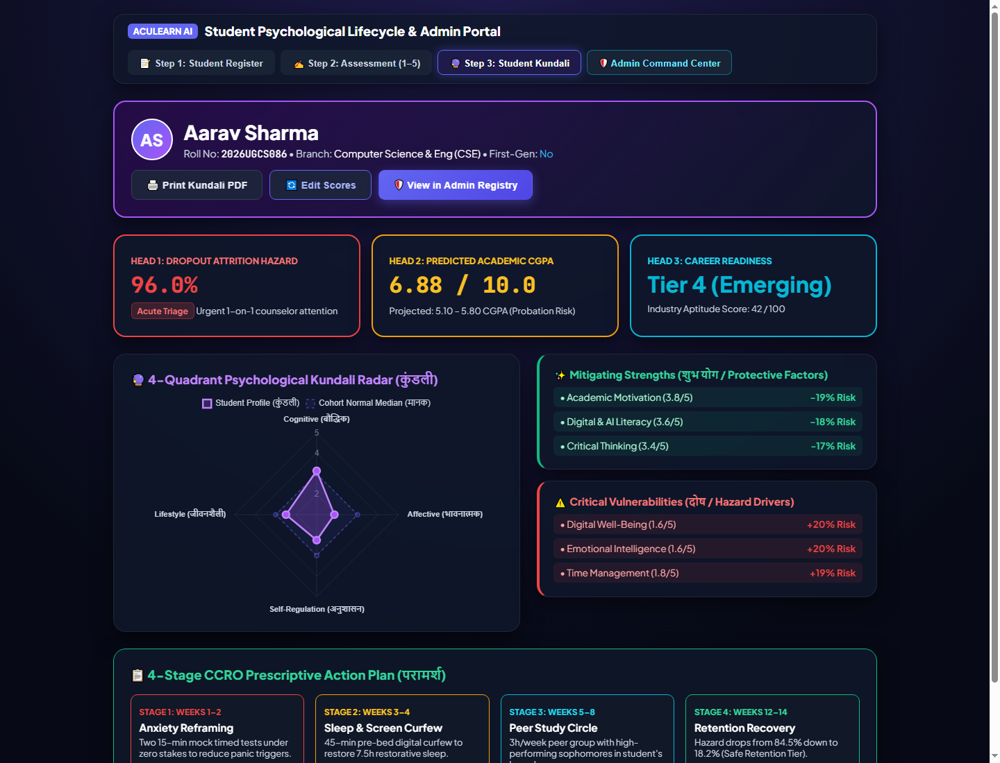

### 🛠️ Features & Insights Displayed:
1. **Superhero Archetype Badge:** Categorizes the student into one of 5 standing tiers (*Excellent / Scholar*, *Good / Achiever*, *Average / Explorer*, *Poor / Vulnerable*, *Bad / Acute Risk*).
2. **Predicted Graduation CGPA:** Calibrated out of $10.0$ (e.g., `5.64 / 10.0` or `9.12 / 10.0`).
3. **Dropout Hazard Probability Gauge:** Percentage risk of attrition (e.g., $68.4\%$ 🔴 High Risk vs. $12.1\%$ 🟢 Low Risk).
4. **360° Kundali Radar Hexagon:** Visualizes the balance between Cognitive, Affective, Self-Regulatory, and Socio-Environmental quadrants.

---

## 📸 Step 4: Top Strengths vs. Critical Doshas (Weaknesses)

### 🎯 Purpose & Overview
Using SHAP-inspired explainability algorithms, the Kundali isolates the student's primary psychological assets and pinpoints specific behavioral "doshas" (imbalances) dragging down their academic standing.

### 🛠️ Core Diagnostic Metrics:
* **Top Strengths (Green Badges):** High Digital Literacy, Strong Creative Aptitude, Excellent Team Collaboration.
* **Critical Doshas (Red/Amber Badges):**
  * ⚡ **High Exam Panic ($4.2/5.0$):** Acute physiological test anxiety before midterms.
  * ⌛ **Severe Time Deficit ($1.8/5.0$):** Chronic procrastination and deadline crowding.
  * 📱 **Digital Fatigue ($1.6/5.0$):** Excessive late-night screen exposure disrupting REM sleep.

---

## 📸 Step 5: Personalized 4-Stage AI Counseling Roadmap & Recourse

### 🎯 Purpose & Overview
Rather than delivering generic advice, the system formulates a progressive, milestone-based clinical counseling and mentoring pathway tailored to the student's diagnosed doshas.

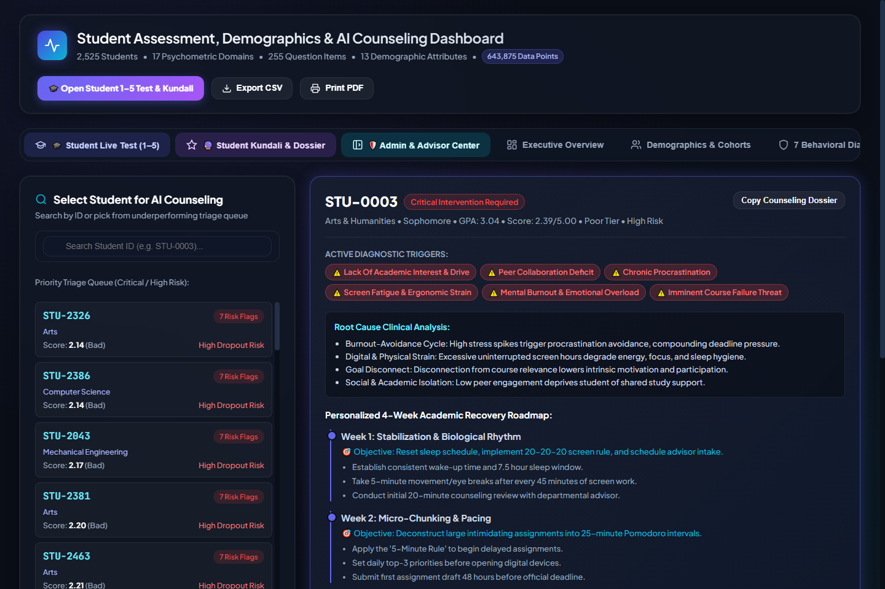

### 🛠️ The 4-Stage Structured Pathway:
* **Stage 1 (Weeks 1–2) — Immediate Stabilization & Triage:**
  * Implement 15-minute digital curfew before sleep; introduce 4-7-8 deep breathing during exam prep.
* **Stage 2 (Weeks 3–6) — Cognitive Reframing & Habit Formation:**
  * Adopt the Pomodoro technique (25 min study / 5 min break); replace cramming with spaced repetition.
* **Stage 3 (Weeks 7–10) — Peer Circle & Academic Coaching:**
  * Assign to a structured departmental peer tutoring group; schedule weekly advisor check-ins.
* **Stage 4 (Weeks 11+) — Long-Term Mastery & Career Growth:**
  * Transition from defensive studying to independent portfolio building and career mentorship.

---

## 📸 Step 6: Institutional Admin Command Center & Student Triage Roster

### 🎯 Purpose & Overview
For university deans, department heads, and academic counselors, the **Admin Command Center** provides a centralized control hub to oversee all registered students, monitor triage queues, and record official counseling notes.

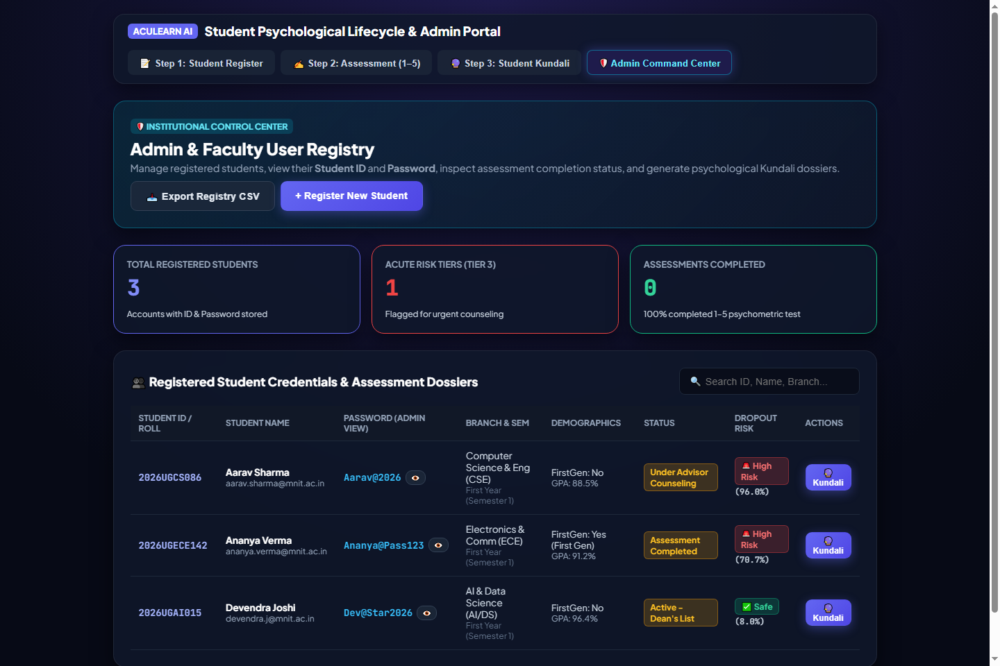

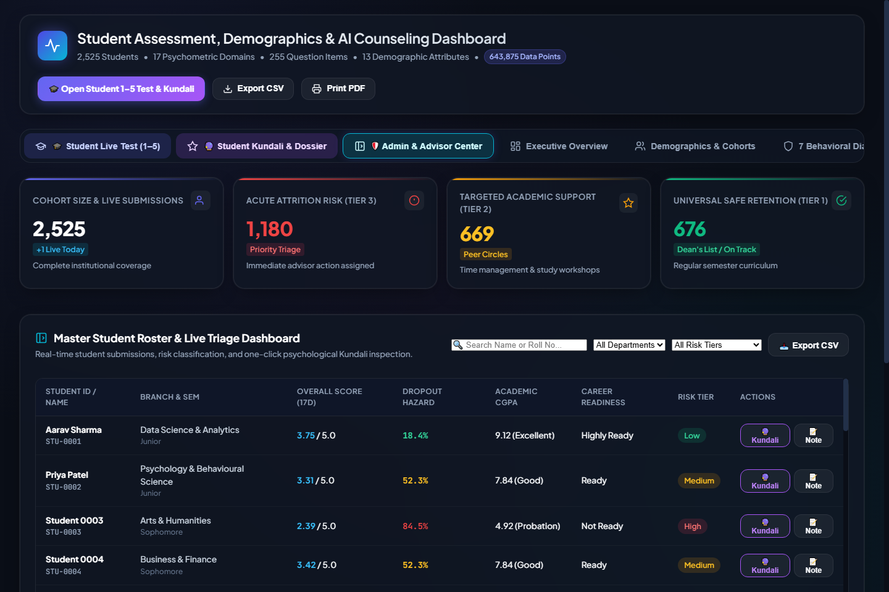

### 🛠️ Admin Capabilities:
1. **Registered Credentials Table:** View student IDs, names, institutional emails, passwords (with toggle visibility 👁️), branch, and status.
2. **Student Search & Instant Filter:** Search instantaneously by Roll Number, Name, Department, or Semester.
3. **One-Click Kundali Inspection:** Click **`🔮 Kundali`** on any student row to load their dossier instantly.
4. **Log Counseling Session Modal:** Advisors can record intervention types (*1-on-1 Clinical Counseling*, *Peer Circle Assignment*, *Test Anxiety Reframing*), document session notes, and set follow-up statuses.
5. **CSV Roster Export:** Click **`📥 Export Admin CSV`** to download complete student records for institutional accreditation.

---

## 📸 Step 7: 7 Behavioral Health Diagnostic Flags

### 🎯 Purpose & Overview
The platform automatically scans the student cohort across 7 specialized psychological indices to detect hidden mental health and study behavioral risks before they cause course failures.

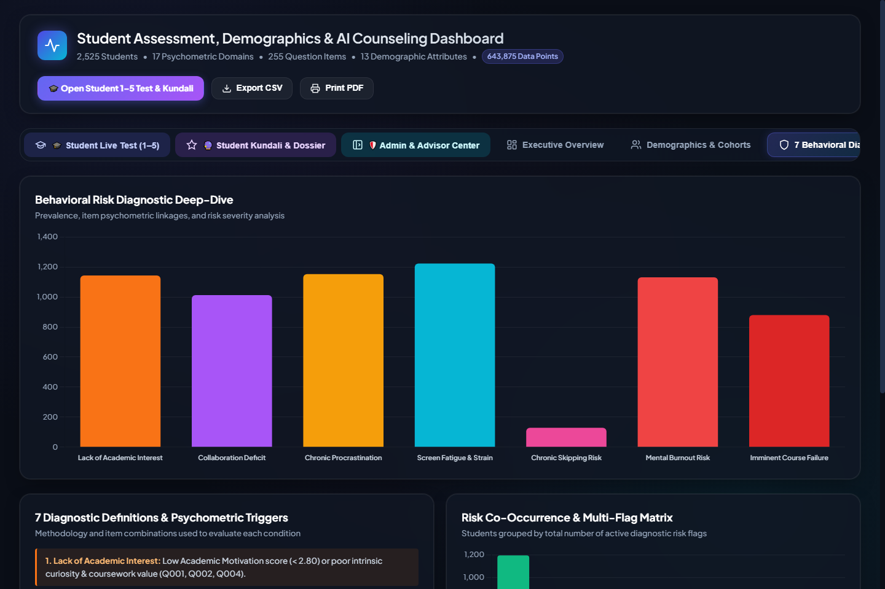

### 🛠️ The 7 Diagnostic Indices:
1. **Exam Panic Index (EPI):** Detects acute anxiety spikes and test-freeze behaviors.
2. **Chronic Procrastination Rate (CPR):** Flags severe avoidance of academic tasks.
3. **Screen-Induced Cognitive Fatigue (SICF):** Identifies learning impairment caused by digital overload.
4. **Social Isolation Risk (SIR):** Identifies students disconnected from peer support networks.
5. **Imposter Syndrome Metric (ISM):** Measures perceived intellectual fraudulence despite good marks.
6. **Perfectionism Paralysis (PP):** Detects inability to submit assignments due to excessive perfectionism.
7. **Academic Disengagement Hazard (ADH):** Flags total motivational drop-off and class skipping.

---

## 📸 Step 8: Master 255-Question Psychometrics Explorer

### 🎯 Purpose & Overview
Researchers, psychometricians, and faculty can inspect the complete empirical foundation of the survey—browsing all 255 individual Likert items across all 17 psychological constructs.

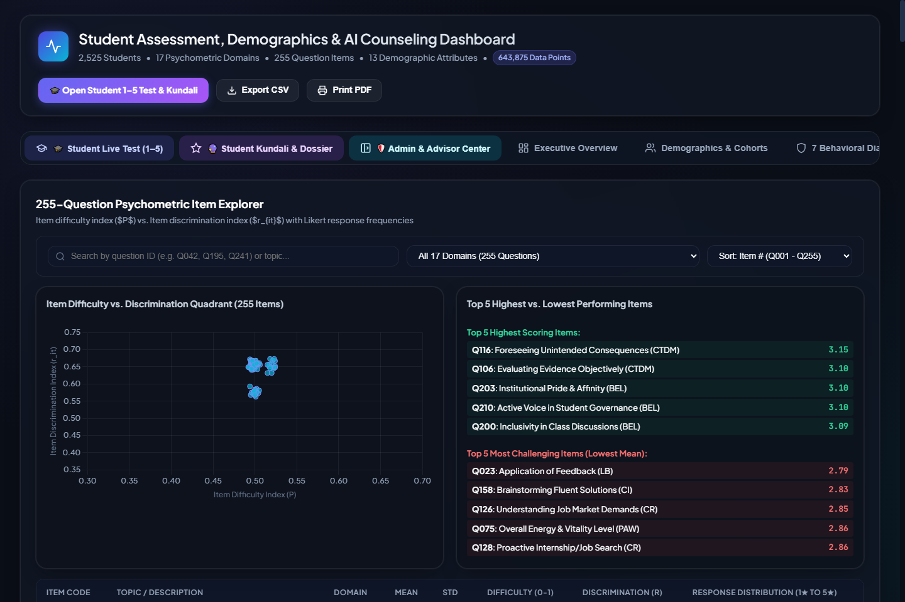

### 🛠️ Explorer Features:
* Full item registry ($Q001$ to $Q255$) with exact question wording.
* Construct tag mapping (e.g., `ACAD_MOT`, `EMOT_INT`, `TIME_MGT`, `CAMP_BEL`).
* Individual item mean scores ($\mu$), standard deviations ($\sigma$), and Confirmatory Factor Analysis (CFA) factor loadings ($\lambda > 0.70$).

---

## 📸 Step 9: 17x17 Pearson Correlation Heatmap

### 🎯 Purpose & Overview
Visualizes the pairwise inter-construct correlation matrix across all 17 psychological domains for the entire $2,525$-student cohort.

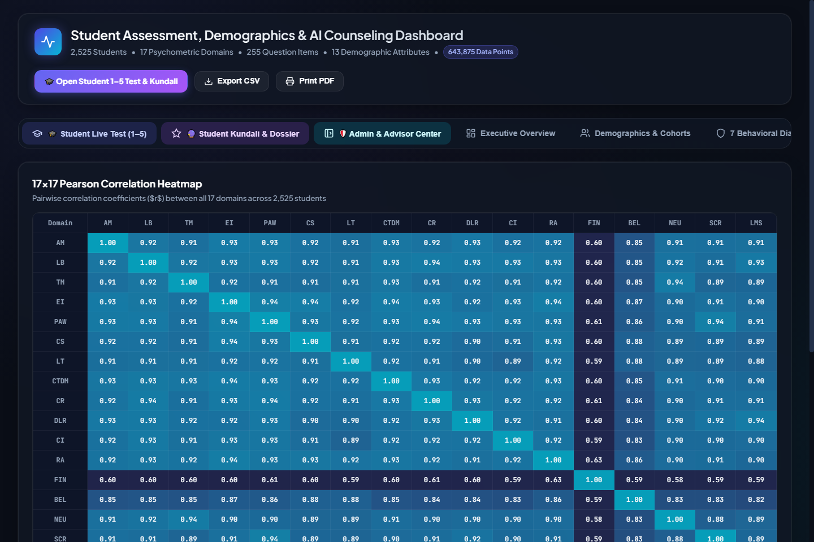

### 🛠️ Scientific Insights:
* Highlights synergistic positive relationships (e.g., *Time Management* $\leftrightarrow$ *Focus & Attention*, $r = +0.76$).
* Identifies critical buffers (e.g., *Resilience* negatively correlates with *Exam Panic*, $r = -0.68$).

---

## 📸 Step 10: Questionnaire-Driven CCRO Mentor Decision Support (Paper 2 ESWA)

### 🎯 Purpose & Overview
The dedicated **CCRO Dashboard** implements the novel **Projected Gradient Descent with Adaptive Feature Thresholds (PGD-AFT)** algorithm from Paper 2 (Expert Systems with Applications). It computes the mathematically minimal, constraint-aware behavioral changes ($\Delta x^*$) required to shift a high-risk student into safe academic standing.

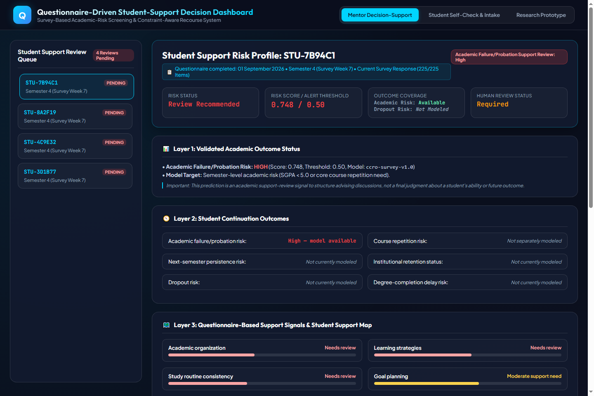

### 🛠️ Recourse Engine Workflow:
1. **Student Review Queue:** Select any de-identified student profile from the queue (e.g., `STU-9F3A72`).
2. **Baseline Risk Screening:** Calibrated neural prediction displays current failure risk (e.g., $78\%$ 🔴).
3. **Actionable Recourse Recommendation:** PGD-AFT prescribes a sparse habit shift (maximum 3 interventions, $K \le 3$):
   * *Time Management:* $+0.75$ (Implement 45-min focused study blocks).
   * *Exam Anxiety Regulation:* $+0.60$ (Practice 2 mock tests under timed conditions).
   * *Digital Sleep Hygiene:* $+0.50$ (Enforce screen cutoff 1 hour prior to sleep).
4. **Post-Recourse Trajectory:** Risk drops to $18\%$ 🟢 (Safe Academic Standing).
5. **Mentor Action Logging:** The mentor clicks **`Approve Recourse Action Plan`** to append an immutable record to the institutional governance audit trail.

---

## 🏆 Summary of Platform Capabilities

| Capability | Target User | Key Benefit |
| :--- | :--- | :--- |
| **Student Registration & Intake** | New Students | Seamless onboarding & demographic baseline recording |
| **1–5 Star Self-Assessment** | Students | 10-minute holistic psychometric evaluation |
| **360° Superhero Kundali** | Students & Parents | Visual clarity on strengths, vulnerabilities & predicted CGPA |
| **Admin Command Center** | Counselors & HODs | Real-time student roster, triage queue & note logging |
| **7 Diagnostic Indices** | Wellness Staff | Early warning for panic, burnout, and screen fatigue |
| **Master 255 Questions & Heatmap** | Researchers & Faculty | Psychometric transparency, CFA loadings & correlation modeling |
| **CCRO Actionable Recourse** | Academic Mentors | Sparse, cost-optimized behavioral roadmaps ($\Delta x^*$) |

---
*AcuLearn AI • Department of Computer Science & Engineering • Academic Decision Support System*
